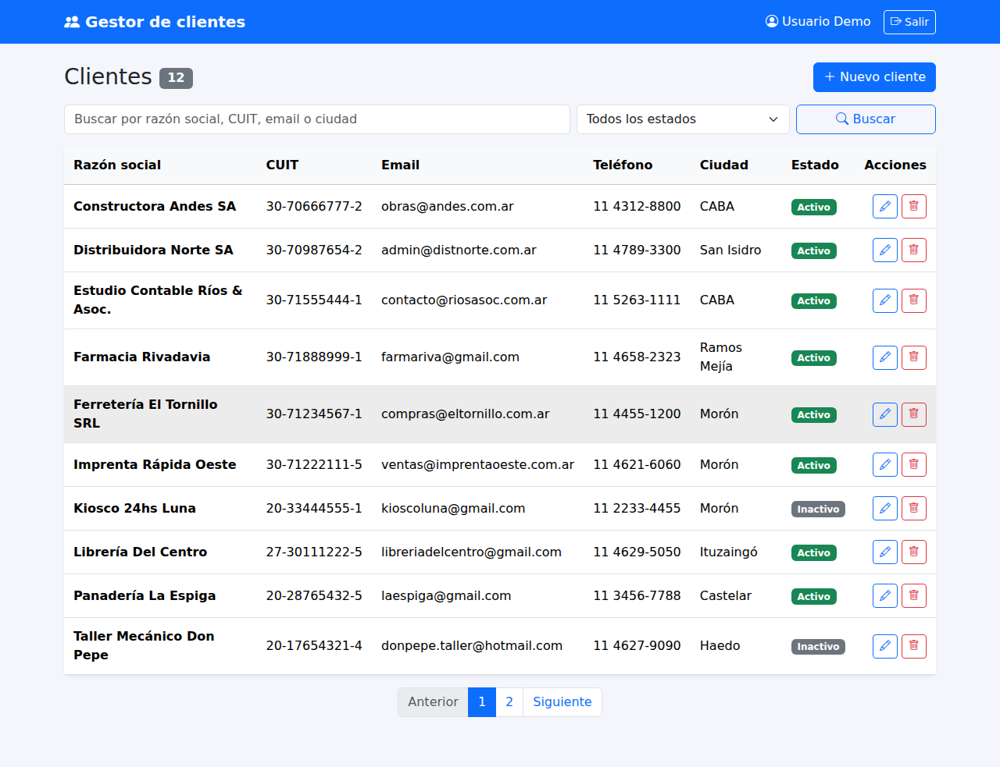
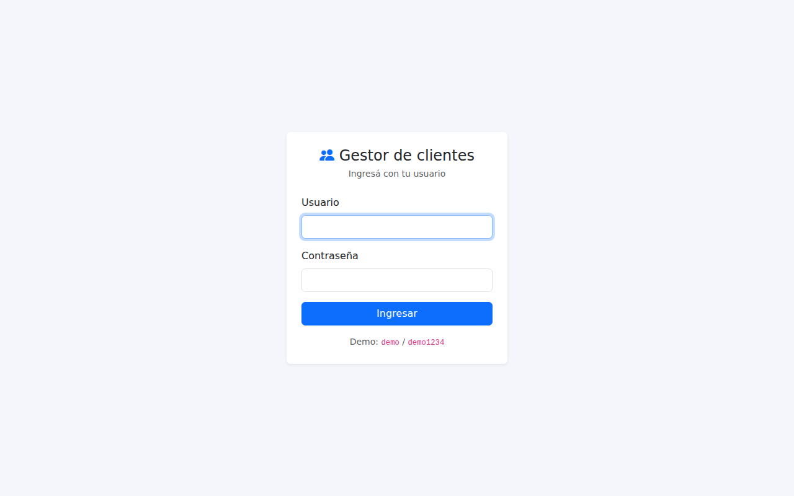
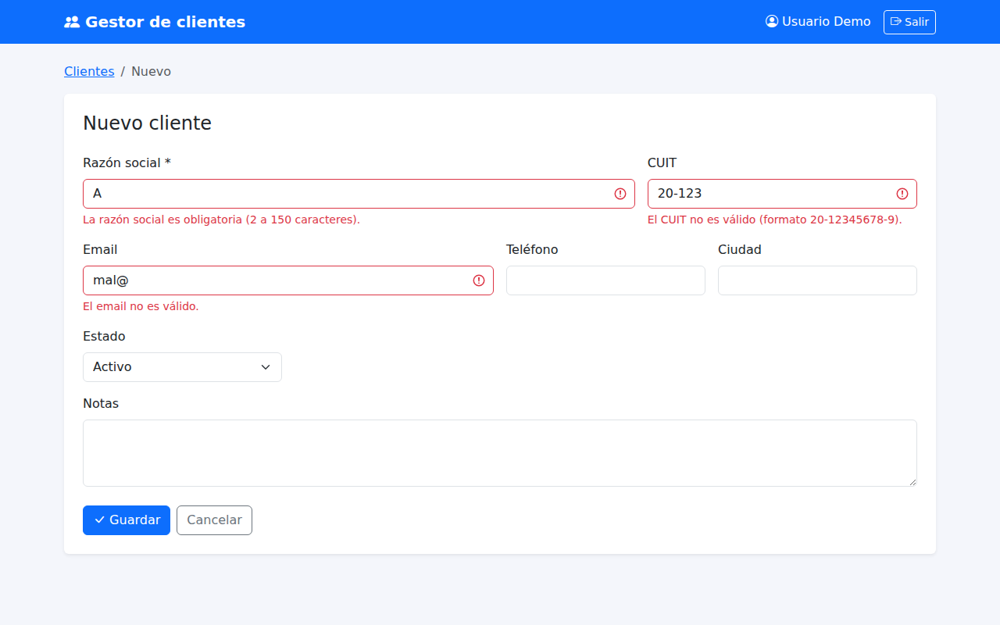
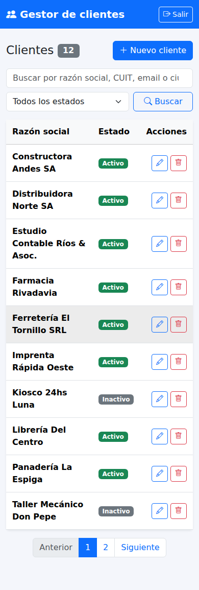

# Client Manager

[Versión en español](README.md)

Client CRUD (create, read, update, delete) with login, built in **plain PHP** (compatible with PHP 5.6 to 8.x), **MySQL**, **Bootstrap 5** and **jQuery**. The interface is in Spanish.



## Features
- Login with hashed passwords (`password_hash` / `password_verify`), session regeneration and a 5-minute lockout after 5 failed attempts.
- List with search (company name, CUIT tax ID, email, city), status filter and pagination.
- A single form for create and edit, with server-side validation: CUIT check digit, unique CUIT, email and phone.
- Delete through a confirmation modal, POST only.
- jQuery auto-formats the CUIT as you type.

## Security
| Risk | How it is handled |
|---|---|
| SQL injection | Every query is a PDO prepared statement (`includes/clientes.php`). |
| XSS | All output goes through `htmlspecialchars` (the `e()` helper). |
| CSRF | Per-session token on every POST form (`verificar_csrf()`). |
| Brute force | Login attempts limited per session. |
| Access to internal files | `.htaccess` denies `includes/`, `data/` and `sql/`. |

## Structure
```
index.php        List, search and pagination
cliente.php      Create and edit
eliminar.php     Delete (POST + CSRF)
login.php        Sign in
logout.php       Sign out (POST + CSRF)
includes/
  config.php     Database settings
  db.php         PDO connection (MySQL, or SQLite in demo mode)
  funciones.php  Session, authentication, CSRF, flash messages
  clientes.php   Client queries and validation
  layout.php     Shared header and footer
sql/schema.sql   MySQL tables + demo user
```

## Documented test cases
| # | Case | Expected result |
|---|---|---|
| 1 | Open `index.php` without a session | Redirects to `login.php`. |
| 2 | Login with a wrong password | "Usuario o contraseña incorrectos"; on the 5th attempt, 5-minute lockout. |
| 3 | Create with a 1-letter name, invalid CUIT and malformed email | Not saved; each of the three fields shows its error. |
| 4 | Create with an existing CUIT | Not saved; "Ya existe un cliente con ese CUIT". |
| 5 | Company name containing HTML (`<b>Test</b>`) | Stored as typed and displayed escaped, never rendered as HTML. |
| 6 | Delete sent with an invalid CSRF token | Returns 403 and deletes nothing. |
| 7 | Search "Almac" and filter "Inactivos" | Lists only matches and updates the counter. |

## Installation
**Local (demo mode):** `php -S localhost:8000` and sign in with `demo` / `demo1234`. It creates `data/demo.sqlite` with 12 sample clients.

**Server with MySQL (e.g. InfinityFree):**
1. Create the database and run `sql/schema.sql` in phpMyAdmin.
2. Fill in `DB_DSN`, `DB_USER` and `DB_PASS` in `includes/config.php`.
3. Upload the files to `htdocs/`.

## Screenshots
| Login | Validation | Mobile |
|---|---|---|
|  |  |  |
